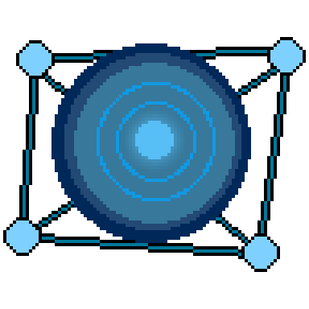

#  AtomSpace

Got a phone and a room? Walk around filming for a minute or two, run one command, and step inside your own space in the browser. AtomSpace is still in its early stages, so expect a few rough edges!

**[Try it now :D!](https://atomspace-deploy.vercel.app/?scene=friendroom-r30)**

## Setup

### Requirements

- **Viewer and CPU stages:** Node 20+, Python 3.10+, any modern browser.
- **GPU stages (`reconstruct`, `splat`):** an NVIDIA GPU from the RTX 20 series or newer on WSL2 or Linux, with 8 GB of VRAM recommended and 4 GB the minimum.

### Clone

```bash
sudo apt install -y git-lfs    # do this first, or large files arrive as small text pointers
git clone --recursive https://github.com/SoloBeing/AtomSpace.git
cd AtomSpace
```

### GPU machine

Follow [env/README.md](env/README.md). In short:

```bash
bash env/setup_wsl.sh          # conda environment, ASMK, curope, gsplat
bash env/download_weights.sh   # about 3 GB from Hugging Face; safe to interrupt and re-run
conda activate atomspace
python env/smoke_test.py
```

`setup_wsl.sh` needs conda, so it doesn't work on Google Colab. There, gsplat installed with:

```bash
TORCH_CUDA_ARCH_LIST=7.5 MAX_JOBS=2 pip install --no-build-isolation git+https://github.com/nerfstudio-project/gsplat.git@v1.5.3
```

### Viewer

```bash
cd viewer
npm install
npm run dev
```

Open `http://localhost:5173/?scene=<name>`. Add `&admin` for the scale and POI tools, which only work on the dev server.

## Reconstruct the sample scene

[`test/testroom/frames/`](test/README.md) holds the 101 keyframes from our test room, so you can skip capture and ingest:

```bash
cp -r test/testroom/frames scenes/testroom/
atomspace reconstruct testroom
atomspace splat testroom
atomspace bundle testroom
cd viewer && npm install && npm run dev
```

Then open `http://localhost:5173/?scene=testroom`. `scenes/testroom/ingest.json` is already in the repository and lists the keyframes.

Expect a result like Room-2 in the live demo, including the eye-level black band, because this capture was tilted down throughout. Room-1 shows what a better capture can do.

## Reconstruct your own space

Walk the room slowly in layered loops at different heights, finish where you started, and add close-ups of important objects. Use 1080p, with HDR, beauty modes and heavy stabilisation turned off.

```bash
atomspace run myroom path/to/video.mp4   # ingest, reconstruct, splat, bundle

# optional: metric scale, then collision
atomspace scale myroom --a 0.1 0.0 2.3 --b 0.1 1.1 2.3 --distance 2.0
atomspace navmesh myroom && atomspace bundle myroom
```

`--a` and `--b` are two points in reconstruction space, and `--distance` is their real separation in metres. The viewer's scale tool (`&admin`) picks them by clicking. Each stage reruns on its own: `atomspace {ingest,reconstruct,splat,scale,navmesh,bundle} <scene>`.

## Controls

| Action | Laptop | Phone |
|---|---|---|
| Walk | W A S D | Left thumb |
| Sprint | Hold Shift | Not available |
| Look | Click the scene, then move the mouse | Right thumb |
| Free the cursor | Esc | Not needed |

## Deploy

The viewer is static, so any static host works, and no special headers are needed.

```bash
cd viewer && npm run build
```

Serve `viewer/dist/` with each scene at `/scenes/<name>/bundle/`, or set `VITE_SCENES_BASE_URL` at build time to host scenes elsewhere.

To offer a choice of worlds, add `worlds.json` beside the scene folders. Visitors to the bare address then get a carousel, while `?scene=<name>` still opens a scene directly:

```json
{
  "format_version": 1,
  "worlds": [{ "scene": "testroom", "name": "Test Room" }]
}
```

A world's card shows `bundle/thumbnail.jpg` from its scene, or a plain background if there isn't one. Without `worlds.json`, visitors need `?scene=<name>` in the URL.

## Tests

```bash
cd pipeline && pip install -e ".[dev]" && pytest -q     # 33 tests, no GPU needed
cd viewer && npx tsc --noEmit && npx vitest run         # 9 tests
```

## License

AtomSpace's own code is under the [MIT License](LICENSE).

**MASt3R, DUSt3R and CroCo, including their weights, are CC BY-NC-SA 4.0, so using this pipeline to reconstruct a scene is non-commercial only**, whatever the license on our code. See [THIRD_PARTY_NOTICES.md](THIRD_PARTY_NOTICES.md), which also covers the images and sample data.
